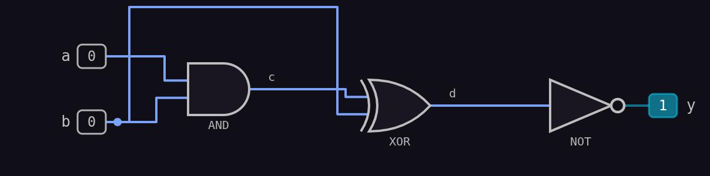
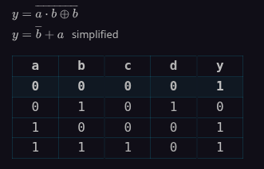

# Logic Graph for Obsidian

Draw logic circuits, truth tables, Karnaugh maps, and timing diagrams straight from a plain-text code block.

```logic
(a,b) AND (c)
(c,b) XOR (d)
(d) NOT (y)
```




## Features

- **Circuit diagrams** — AND, OR, NAND, NOR, XOR, XNOR, NOT, and BUF gates (2–6 inputs each), drawn as clean SVG with live signal state.
- **Truth tables** — click a row to drive the circuit; rows update the diagram instantly.
- **Karnaugh maps** — 2 to 6 inputs, with the Quine–McCluskey minimal cover and coloured groups (exact minimum when the search is small enough).
- **Boolean expressions** — both the structural expression of your circuit and the simplified sum-of-products form, rendered as LaTeX.
- **Timing diagrams** — optional per-gate delay; waveform view and/or animated bit-travelling view.
- **Bubble pushing** — De Morgan symbol matching, with per-gate manual flips.
- **Circuit reduction** — structural rewrites (double NOT, NOT-into-NAND/NOR, merged cascades, absorption, shared gates, buffers) and two-level methods (SOP, POS, NAND-NAND, NOR-NOR). Every reduced circuit is verified against the original before it is shown.
- **Export** — copy the truth table as Markdown, the expressions as LaTeX, the circuit as Mermaid, or save the diagram as PNG/SVG into your vault.
- **Templates** — half adder, full adder, multiplexer, decoder, majority, parity, XOR-from-NAND.
- **`@help`** — drop `@help` into a block for a full in-app reference with live examples.

## The block syntax

One gate per line: `(inputs) GATE (output)`.

```logic
(a,b) XOR (sum)
(a,b) AND (carry)
```

Signals no gate drives are the inputs; signals nothing uses are the outputs. Names may contain letters, digits, and `_`. Comments start with `#` or `//`.

Directives (at the top of a block):

| Directive | Effect |
| --- | --- |
| `@help` | Show the reference above the circuit. |
| `@hide table` / `@show kmap` | Toggle `table`, `expr`, `diagram`, `kmap`, `timing`. |
| `@simplify structural` (or `@reduce`) | Draw a reduced circuit. Methods: `structural`, `best`, `sop`, `pos`, `nand`, `nor`, `off`. |
| `@bubbles` | Bubble-pushing view; click a gate to flip it by hand. |
| `@compact` | Merge truth-table rows that don't depend on some inputs (shown as `X`). |
| `@delay 0.5` / `@delay random` / `@delay off` | Per-gate delay (0–30 s, or random 0–5 s). |
| `@timing-graph` / `@timing-animation` / `@timing-both` | Delay on, with the chosen timing view. |

## Companion extension: image import

The separate **Logic Graph – Image Import** extension turns a picture of a circuit into a block, entirely on your device. Install both plugins to use it; this plugin works fully without it. See that extension's README for details.

## Installing

1. Copy both plugin folders into `<vault>/.obsidian/plugins/<id>/`.
2. Enable them in **Settings → Community plugins**.

(You only need the import extension if you want to import from images.)

## Known limits

- Truth tables, Karnaugh maps, and minimisation work up to **12 inputs** (2ⁿ rows).
- Diagrams and simulation work up to **32 inputs** and **256 gates**.
- Very large circuits may export to PNG with fine detail compressed; SVG export is exact.
- Timing animation is illustrative; for very fast gate chains several sprites may overlap.

## Reporting issues

- GitHub: <https://github.com/Clemm0/Logic-Graph/issues>
- Discord: <https://discord.gg/2cJt5CBTKa>

I'll respond as soon as I can.

## Support me

If Logic Graph saves you time, you can buy me a coffee or support the project on Patreon — it genuinely helps and keeps the plugin free for everyone.

- Ko-fi: <https://ko-fi.com/clemm0>