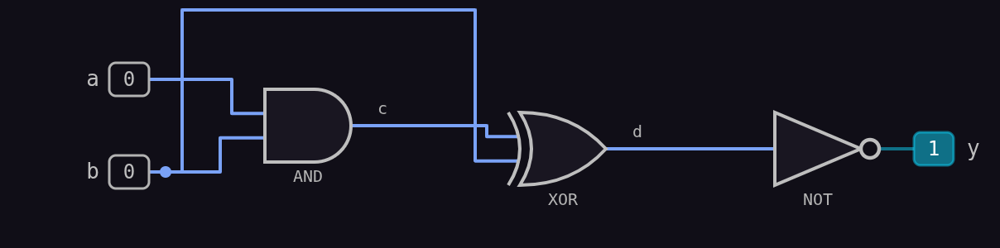
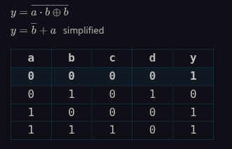

# Logic Graph for Obsidian

Draw logic circuits, truth tables, Karnaugh maps, and timing diagrams straight from a plain-text code block.

```logic
(a,b) AND (c)
(c,b) XOR (d)
(d) NOT (y)

```




This repository holds two Obsidian plugins:

| Package | Plugin ID | What it is |
| --- | --- | --- |
| [`Logic-Graph`](Logic-Graph) | `Logic-Graph` | The main plugin: parser, analysis, drawing, and settings. |
| [`Logic-Graph-Import`](Logic-Graph-Import) | `Logic-Graph-Import` | Optional companion: turns a picture of a circuit into a block, completely offline. |

## Installing the extension

1. Copy the folders in this repo into your `<vault>/.obsidian/plugins/<id>/`.
2. Enable the plugins inside your Obsidian settings.
*(Make sure to install both folders if you want to use the image import feature!)*

---

## Known limits

* **Input & Gate Caps:**
  * Truth tables, Karnaugh maps, and minimisation work up to 12 inputs ($2^n$ rows, this can create really big tables, since if there are just 10 inputs it's already 1024 rows!).
  * The diagram rendering and simulation work up to 32 inputs and 256 gates.

* **Image Import (Experimental):**
  * Image import is still a bit buggy and sometimes fails to recognise certain gates.
    * Right now, it handles simple circuits with about 80% accuracy. (The main problem right now are N-Gates, since they can get flipped for their counterpart, i.e. a NAND could become an AND and viceversa)
    * I'm actively working on fixing reading errors by "training" it with tons of graph samples (everything from hand-drawn gates to photos taken in dim or super bright lighting).
    * I'm also searching for dataset repos ranging from simple setups (max 16 items) all the way to heavy-duty circuits (up to the plugin cap of 32 inputs and 256 gates).
      * If you know any PLEASE create an Issue on GitHub or a Ticket on Discord, since it could help a lot.
      * If you want to send in logic graphs you've made (by hand or digitally), feel free to submit them! You'll get to see how the model parses your circuit, plus you'll get a shoutout in Contributors.md on the repo page featuring your name, your submitted graph, and the recognition results obtained!

* **PNG & SVG Exporting:**
  * Exporting works fine most of the time, but if a circuit gets too massive, it might stretch out sideways or end up a bit pixelated because the details are too tiny to fully render.
  
* **Markdown Table Exporting**
  * Another known issue is that the Export Table in Markdown returns a broken table and I'm working on that too

* **Timing Graph Bugs:**
  * The animation in the timings sometimes shows 2 values on the line instead of one. Don't worry—it's just a visual glitch and won't affect how your circuit actually works!
  * Quick heads-up: on timing graphs, if you select 2 or more different examples at once, the graph length sometimes keeps growing because it's expecting a specific value but gets a different one instead.

---

## How to report issues

Got a bug or a feature request? Here are the best (and only at the moment) ways to reach me:

* **The Git way:** Open an [Issue report on GitHub](https://github.com/Clemm0/Logic-Graph/issues).
* **Direct message:** Catch me over on [Discord](https://discord.gg/2cJt5CBTKa).

> If I fail to answer your problems with this plugin right away, I'm sorry! I'll reach out as soon as possible.
